# 📅 EventHub — Sprint 3 Accounts Modülü Ekran Kataloğu (v2 Revize)

> **Ders / Kurum:** Iğdır Üniversitesi Mühendislik Fakültesi — Yazılım Mühendisliği 4. Sınıf  
> **Ders Adı:** Yazılım Sınama ve Doğrulama Dersi  
> **Modül:** `team-accounts`  
> **Geliştirici:** Yusuf Şanverdi ([@yusufsanverdi](https://github.com/yusufsanverdi))  
> **Product Owner:** Abdülselam Onakbaş ([@abdulselam-code](https://github.com/abdulselam-code))  
> **Scrum Master:** Fatma Sümeyye ([@fatmasumeyye](https://github.com/fatmasumeyye))  
> **QA / Tester:** Polat Bilir ([@polat1443](https://github.com/polat1443))  
> **İlgili PR:** [#30: feat(accounts): sprint 3 interfaces and services (TG-68 - TG-82)](https://github.com/iu-dev-hub/eventhub/pull/30)  
> **Otomatik Test Başarısı:** %100 Yeşil (177 / 177 test başarılı, %100 Statement & Branch Kapsaması)

---

## 🎨 v2 Tasarım Revizyonları (PO & SM Geri Bildirimleri Doğrultusunda)

Product Owner Abdülselam Onakbaş'ın 13 ekranlık referans tasarım prototipi ve Scrum Master Fatma Sümeyye'nin geri bildirimleri doğrultusunda şu görsel iyileştirmeler yapılmıştır:

1. **Giriş Paneli (Ekran 1):** Sol tanıtım paneline yüksek çözünürlüklü konser/etkinlik sahne görseli ve üzerine koyu lacivert degrade kaplama eklendi.
2. **Kayıt Formu (Ekran 3 & 4):** Referans taslağa tam uyum için "Adınız" ve "Soyadınız" giriş alanları yan yana düzenden çıkarılıp alt alta dikey form akışına dönüştürüldü.
3. **Misafir Karşılama Ekranı (Ekran 6):** 4 özellik kartı masaüstünde tek bir yatay satırda (4 sütunlu ızgara) dizildi; "Giriş Yap" ve "Ücretsiz Hesap Oluştur" butonları kartların altına konumlandırıldı.
4. **Hukuki Bilgilendirme Modal Pencereleri (Ekran 11 & 12):** Kullanıcı kayıt formundan ayrılmadan, sayfa üzerinde açılan, kaydırılabilir gövdeli ve kapatma butonlu (`✕`) modern modal diyaloglar entegre edildi.
5. **Kurumsal Bilgiler:** Tüm sözleşme ve bilgilendirme metinleri "Iğdır Üniversitesi Yazılım Mühendisliği 4. Sınıf Yazılım Sınama ve Doğrulama Dersi" olarak güncellendi.

---

## 📱 Mobil Görünümler Neden Geliştirildi?

1. **Product Owner Onaylı 13 Ekran Taslak Prototipi:**
   Sprint başında belirlenen UI taslağında **Ekran 2 (Giriş Mobil)**, **Ekran 4 (Kayıt Mobil)**, **Ekran 7 (Misafir Mobil)**, **Ekran 9 (Dashboard Mobil)** ve **Ekran 10 (Profil Mobil)** bağımsız kabul kriteri olarak yer almıştır.
2. **Taiga Görev Gereksinimleri:**
   - **TG-70 (`PB-03` - Responsive Giriş ve Kayıt Tasarımı):** Masaüstü çift panelli düzenin mobil ekranlarda tek sütuna uyarlanması zorunlu tutulmuştur.
   - **TG-80 (`PB-13` - Ortak Görsel Tasarım ve Bileşen Standardizasyonu):** 768px altı mobil breakpoint'lerde dokunmatik hedeflerin (`min-height: 44px`) ve esnek kartların sunulması şart koşulmuştur.
3. **Kullanıcı Ergonomisi & Etkinlik Katılımcı Profili:**
   Etkinlik biletleme ve katılım platformlarında kullanıcıların büyük çoğunluğu mobil cihazlardan erişir. Masaüstü geniş düzeni mobilde yatay kayma yapmaması için mobil arayüzler optimize edilmiştir.

---

## 🖼️ Ekran Görüntüleri Galerisi

### 1. Giriş Arayüzü (Ekran 1 & Ekran 2)
* **Rota:** `GET /accounts/login` | **Taiga:** TG-69, TG-70
* **Açıklama:** Masaüstünde konser sahnesi arka planlı hero panel ve sağ form alanı; mobilde logo ve tek sütunlu ergonomik akış.

| Ekran 1: Masaüstü Görünümü (Konser Hero) | Ekran 2: Mobil Görünüm (Logo Başlıklı) |
| :---: | :---: |
| 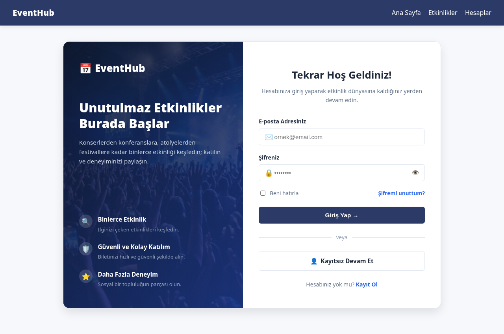 | 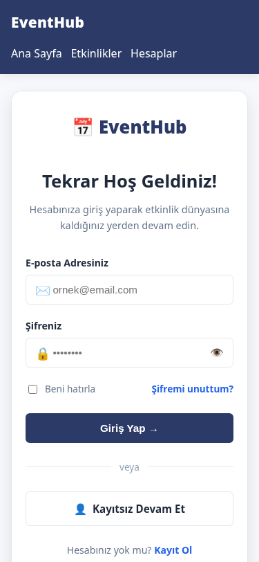 |

---

### 2. Kayıt Arayüzü (Ekran 3 & Ekran 4)
* **Rota:** `GET /accounts/register` | **Taiga:** TG-68, TG-70, TG-78
* **Açıklama:** Dikey sıralı Ad ve Soyad alanları, E-posta, Şifre kuralları göstergesi, Dinamik Öğrenci Numarası alanı ve Modal tetikleyicili onay kutusu.

| Ekran 3: Masaüstü Kayıt Formu (Dikey Ad/Soyad) | Ekran 4: Mobil Kayıt Formu |
| :---: | :---: |
| 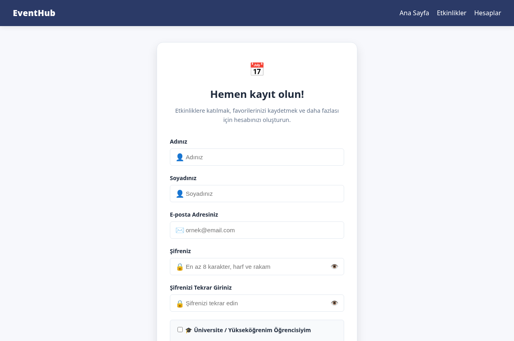 | 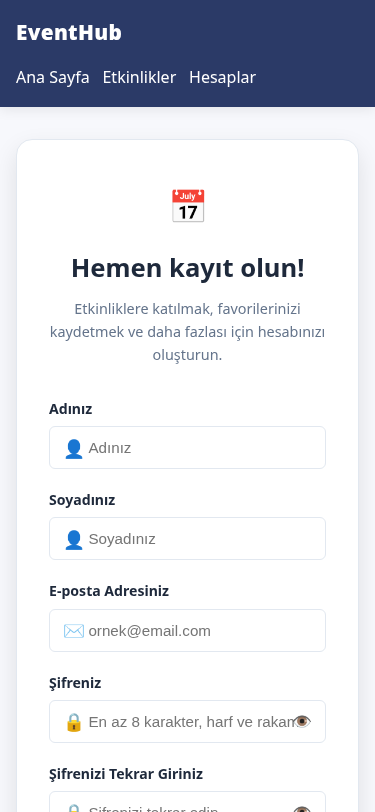 |

---

### 3. Şifremi Unuttum ve Sıfırlama Akışı (Ekran 5a, 5b, 5c)
* **Rota:** `GET /accounts/forgot-password` & `GET /accounts/reset-password/<token>` | **Taiga:** TG-76 (`PB-09`)
* **Açıklama:** OWASP kriptografik token standardı; e-posta sunucusu olmadığından yeşil demo bilgilendirme kutusu üzerinden şifre yenileme.

| 5a: Talep Formu | 5b: Başarı & Demo Token | 5c: Yeni Şifre Belirleme |
| :---: | :---: | :---: |
| 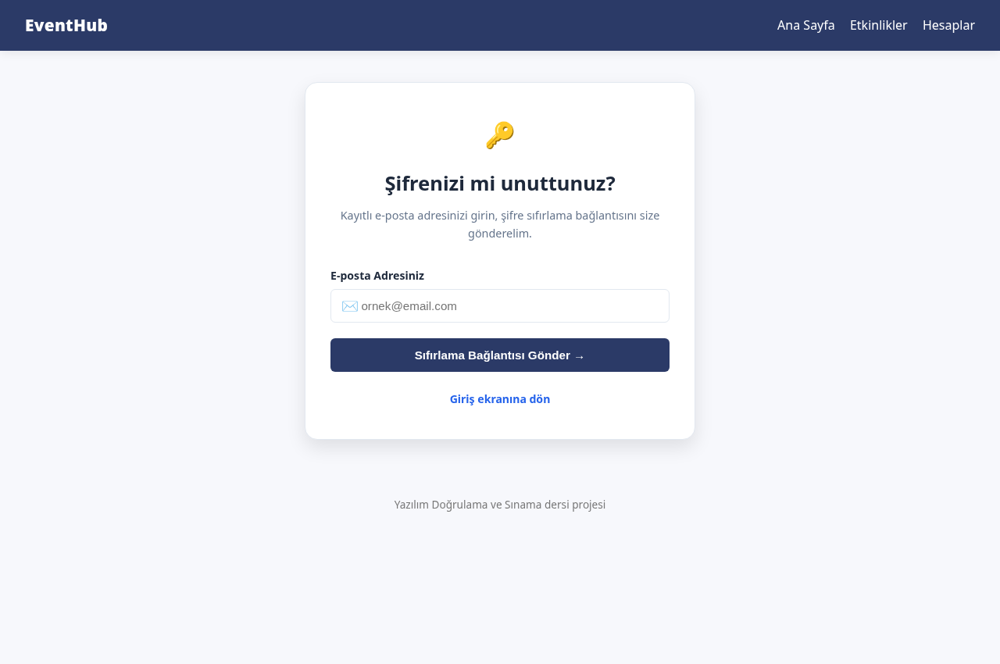 | 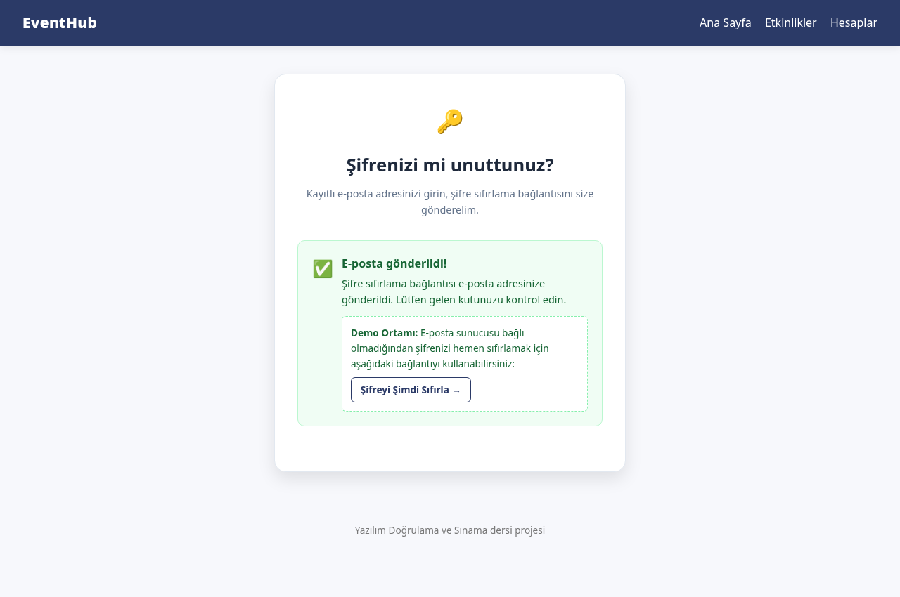 | 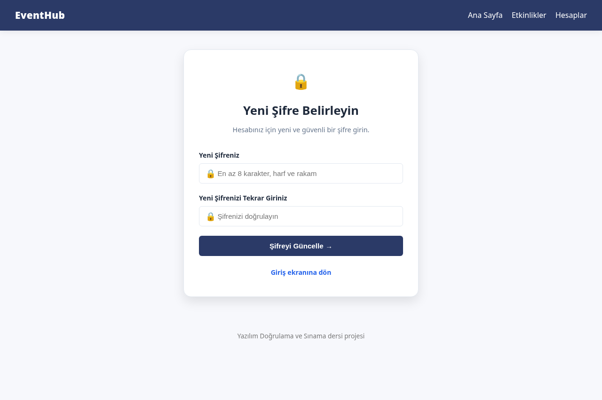 |

---

### 4. Misafir Karşılama Ekranı (Ekran 6 & Ekran 7)
* **Rota:** `GET /accounts/guest` | **Taiga:** TG-77 (`PB-10`)
* **Açıklama:** Geniş hero alanı, tek satırda 4 özellik kartı ve kartların altında konumlanan "Giriş Yap" / "Ücretsiz Hesap Oluştur" butonları.

| Ekran 6: Masaüstü Misafir Karşılama (4'lü Izgara & Alt Butonlar) | Ekran 7: Mobil Misafir Karşılama |
| :---: | :---: |
| 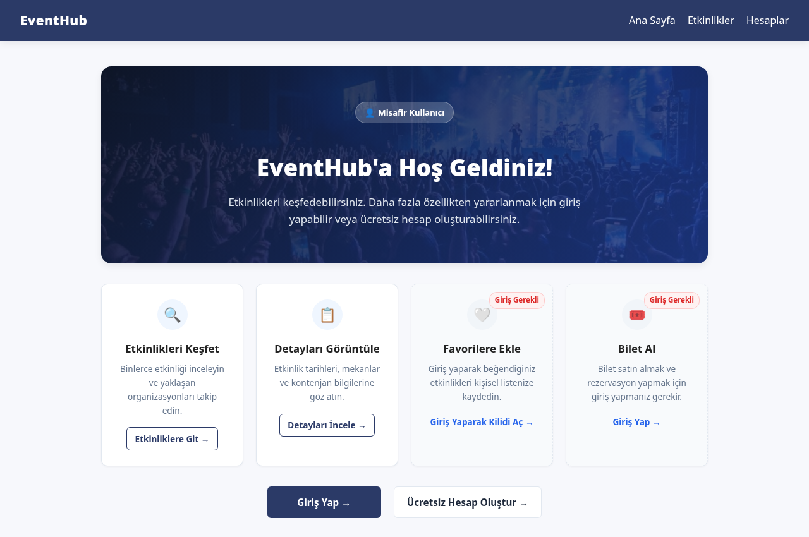 | 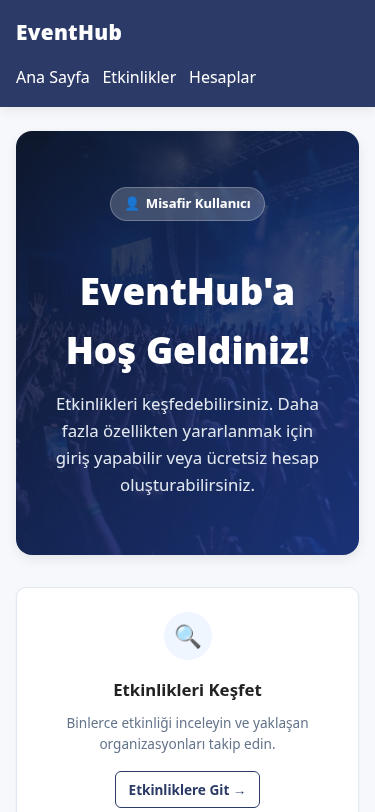 |

---

### 5. Giriş Sonrası Karşılama Paneli / Dashboard (Ekran 8 & Ekran 9)
* **Rota:** `GET /accounts/dashboard` | **Taiga:** TG-71 (`PB-04`)
* **Açıklama:** Sol kenar çubuğu menüsü, mavi geçici izleme paneli bilgilendirmesi ve 3 işlem kartı (Profilim, Ayarlar, Çıkış Yap).

| Ekran 8: Masaüstü Dashboard | Ekran 9: Mobil Dashboard |
| :---: | :---: |
| 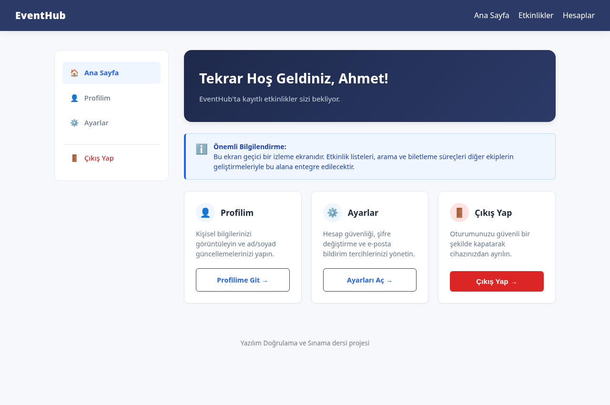 | 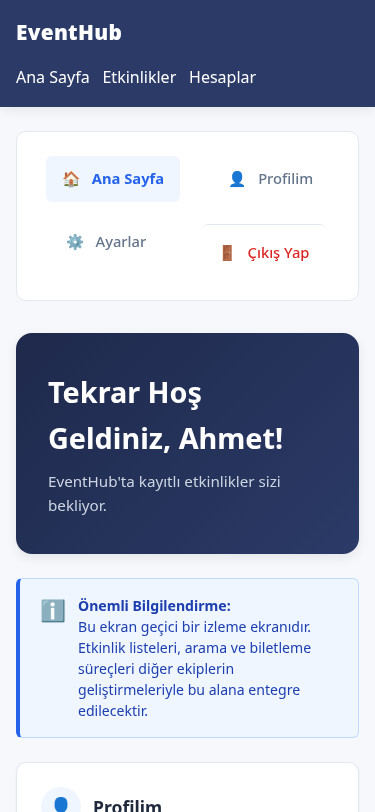 |

---

### 6. Profil Bilgileri & Hesap Ayarları (Ekran 10a, 10b, 10c)
* **Rota:** `GET /accounts/profile` & `GET /accounts/settings` | **Taiga:** TG-72, TG-73, TG-74, TG-75, TG-81
* **Açıklama:** PO kararı gereği yalnızca Ad ve Soyad düzenlenebilir; E-posta ve Rol salt-okunurdur. Ayarlar sekmesinde scrypt ile güvenli şifre değiştirme ve e-posta bildirim tercihleri yer alır.

| 10a: Masaüstü Profil | 10b: Mobil Profil | 10c: Hesap Ayarları & Bildirimler |
| :---: | :---: | :---: |
| 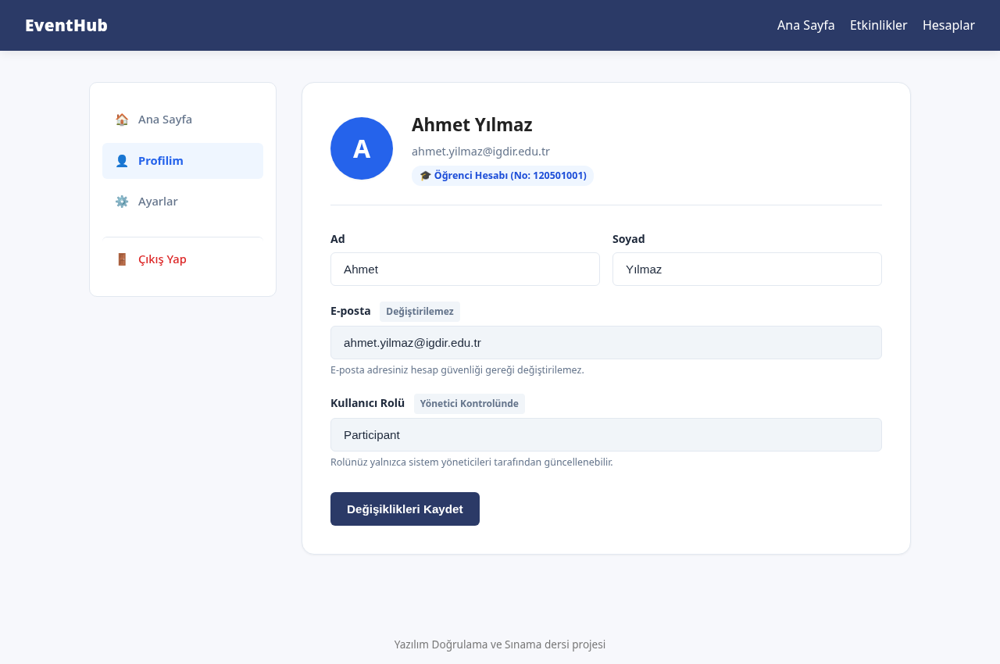 | 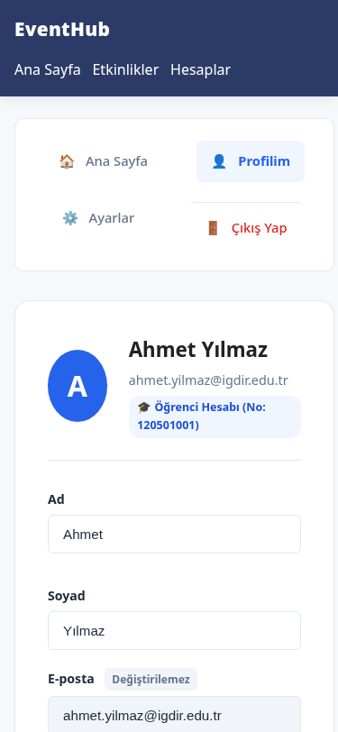 | 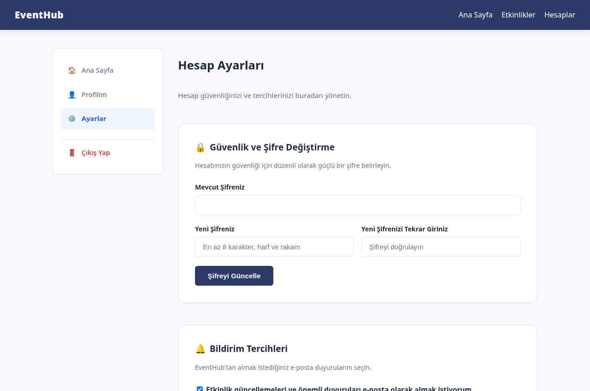 |

---

### 7. Hukuki Bilgilendirme Modal Pencereleri (Ekran 11, 12, 12b)
* **Rota:** `GET /accounts/terms`, `GET /accounts/privacy`, `GET /accounts/kvkk` ve Kayıt Modalları | **Taiga:** TG-79 (`PB-12`)
* **Açıklama:** Kayıt ekranından ayrılmadan açılan, kaydırılabilir içerikli ve kapatma butonlu modal pencereler. Iğdır Üniversitesi Yazılım Mühendisliği 4. Sınıf Yazılım Sınama ve Doğrulama Dersi referansı içerir.

| Ekran 11: Kullanım Koşulları (Modal) | Ekran 12: Gizlilik Politikası (Modal) | Ekran 12b: KVKK Sayfası |
| :---: | :---: | :---: |
| 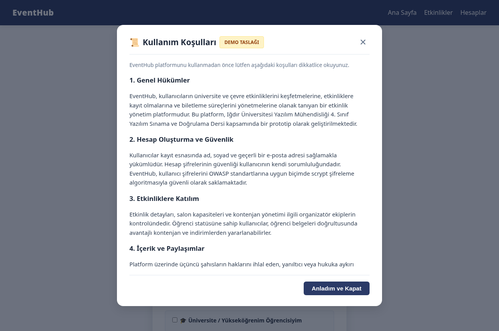 | 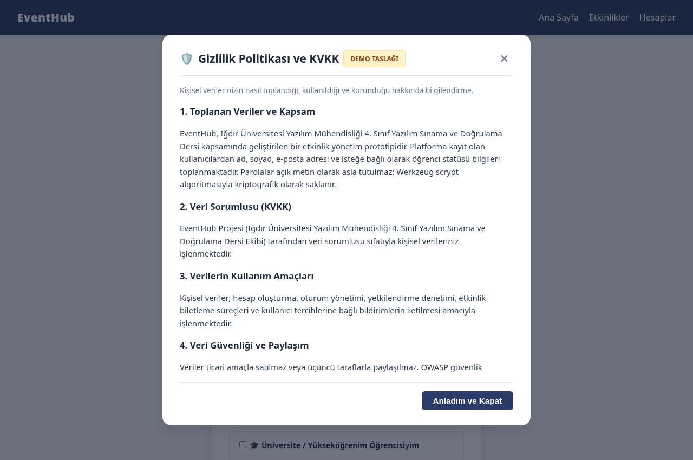 | 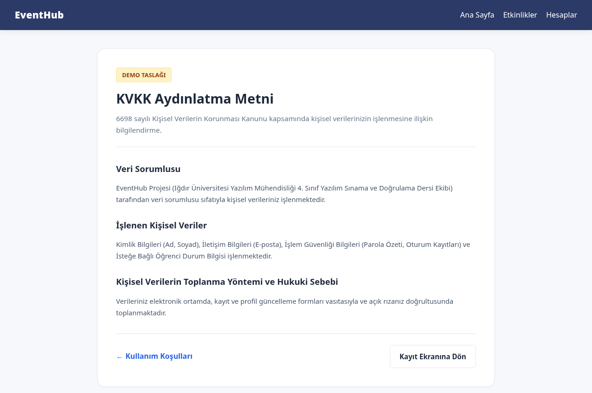 |

---

### 8. Oturum Kapatma Onay Modalı (Ekran 13)
* **Rota:** `POST /accounts/logout` (Modal Diyaloğu) | **Taiga:** TG-69, TG-75
* **Açıklama:** Yanlışlıkla çıkışı önlemek için güvenlik onayı; onaylandığında oturum (`session.clear`) sonlandırılır.

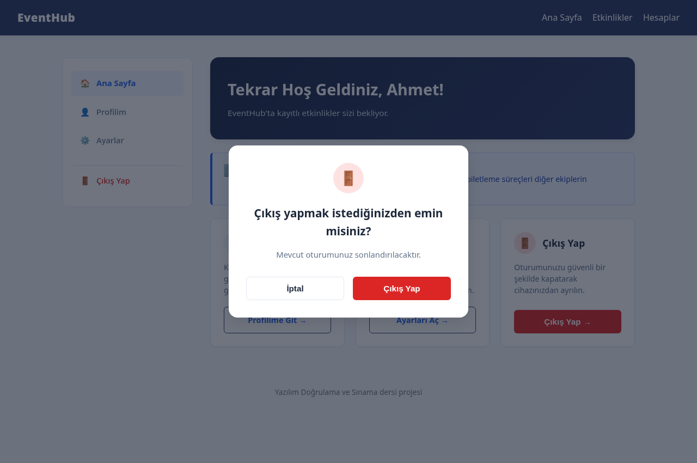

---
*EventHub Projesi — team-accounts Sprint 3 Çıktısı (v2 Revize)*
